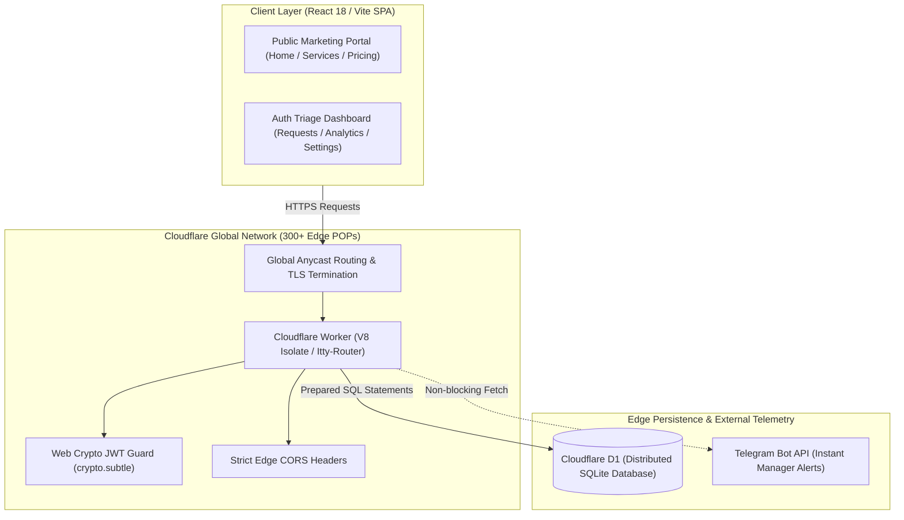

# Edge-Native Serverless CRM & Client Portal

> **High-performance, serverless edge-native CRM portal and lead management architecture deployed on Cloudflare Workers (V8 Isolates), Cloudflare D1 distributed SQL database, Web Crypto JWT authentication, and a reactive React 18 client dashboard.**

[](https://workers.cloudflare.com/)
[](https://developers.cloudflare.com/d1/)
[](https://react.dev/)
[](https://www.typescriptlang.org/)
[](https://vitejs.dev/)
[](https://core.telegram.org/bots/api)

---

## Pitch & Executive Summary

**Edge-Native CRM** is a modern, globally distributed customer relationship management portal designed for ultra-low latency and zero cold starts. By executing application logic at edge locations across 300+ global data centers via **Cloudflare Workers** and persisting state in **Cloudflare D1**, the platform delivers consistent sub-15ms Time-to-First-Byte (TTFB) without traditional server hosting or infrastructure overhead.

The platform unifies a high-converting public landing portal, a role-guarded management dashboard, real-time analytics telemetry, and instant **Telegram** notifications for incoming customer inquiries.

---

## Architecture Overview

The system eliminates centralized database bottlenecks and container boot latency by compiling API routes into lightweight V8 isolate workers distributed across Cloudflare's edge network:



### Architectural Highlights

- **Serverless Edge Runtimes:** Powered by **Cloudflare Workers** and **itty-router**, eliminating idle server costs, server patching, and cold-start latency.
- **Distributed SQL at the Edge:** Uses **Cloudflare D1**, enabling ACID transactions and fast edge reads with automatic schema version migrations.
- **Zero-Dependency Web Crypto Security:** Authentication relies entirely on the standard **Web Crypto API** (`crypto.subtle` HMAC SHA-256), removing heavy Node.js dependencies and guaranteeing compatibility across V8 isolate runtimes.
- **Event-Driven Lead Alerting:** Upon submission of new inquiries, workers trigger asynchronous non-blocking webhooks to Telegram, alerting triage staff within milliseconds.

---

## Key Enterprise Features

### 1. Dual-Scope Web Application
- **Public Conversion Funnel:** Fast-loading marketing pages (Services, Pricing tiers, How It Works, Company info, Contact form).
- **Administrative Portal:** Secure dashboard with stage filtering, inquiry status transitions (`new`, `in_progress`, `completed`, `cancelled`), lead priority scoring, and manager assignment.

### 2. Edge-Calculated Real-Time Analytics
- On-the-fly aggregation of weekly lead volumes, conversion ratios, average resolution durations, and acquisition channel attribution directly via SQL queries on Cloudflare D1.
- CSV / tabular data export pipeline for downstream spreadsheet integrations.

### 3. Hardened Edge Security & Stateless Auth
- JWT tokens signed with HMAC SHA-256 using standard Web APIs.
- Strict CORS verification, rate-protection, and input sanitization directly at the edge boundary before hitting the database.

---

## Tech Stack & Architectural Rationale

| Layer | Technology | Architectural Rationale |
| :--- | :--- | :--- |
| **Edge Compute** | **Cloudflare Workers** | V8 isolate execution delivering instantaneous cold-starts (<5ms) and global multi-region redundancy. |
| **Edge Database** | **Cloudflare D1** | Serverless relational SQLite database natively integrated with Workers for ACID consistency and low-latency access. |
| **Micro-Routing** | **itty-router 4.x** | Ultra-lightweight (under 1KB) routing engine designed specifically for modern edge runtime constraints. |
| **Cryptography** | **Web Crypto API** | Native, hardware-accelerated browser/worker cryptographic primitives eliminating bulky third-party libraries. |
| **Client Frontend**| **React 18 & Vite** | Component-driven presentation layer with fast client-side navigation, typed state contexts, and optimized bundling. |
| **Alert Transport**| **Telegram Bot API** | Direct mobile push dispatch for immediate lead response times without third-party SMS gateway costs. |

---

## Repository Structure

```text
├── src/
│   └── worker/
│       ├── routes/              # Modular Worker API routes (requests, auth, analytics, telegram)
│       ├── utils/               # Web Crypto JWT helpers, CORS headers
│       └── index.ts             # Cloudflare Worker entrypoint & router definition
├── frontend/
│   ├── src/
│   │   ├── pages/               # React views (Dashboard, Requests, Analytics, Home, Pricing)
│   │   ├── contexts/            # React AuthContext and global state providers
│   │   ├── components/          # Reusable UI widgets and navigation bars
│   │   └── App.tsx              # Application route tree
│   ├── package.json             # Frontend dependencies
│   └── vite.config.ts           # Vite build and proxy configuration
├── migrations/                  # Versioned Cloudflare D1 SQL schema migrations
├── wrangler.toml                # Cloudflare Workers & D1 database bindings configuration
├── package.json                 # Worker scripts and dependencies
└── README.md                    # Architecture and deployment guide
```

---

## Getting Started

### Prerequisites

- **Node.js 18.x+**
- **npm** or **pnpm**
- **Wrangler CLI** (`npm install -g wrangler`)

---

### Step 1: Install Dependencies

```bash
# Install root (Worker) dependencies
npm install

# Install frontend dependencies
cd frontend && npm install && cd ..
```

---

### Step 2: Local Development with Cloudflare Workers & D1

1. **Apply local database migrations:**
   ```bash
   npx wrangler d1 migrations apply crm-db --local
   ```

2. **Launch Cloudflare Worker edge backend:**
   ```bash
   npm run dev
   # Worker API listening on http://localhost:8787
   ```

3. **Launch React Frontend:**
   ```bash
   npm run frontend:dev
   # Vite dev server running on http://localhost:5173
   ```

---

### Step 3: Production Deployment to Cloudflare

1. **Create remote D1 database:**
   ```bash
   npx wrangler d1 create crm-db
   # Paste the returned database_id into wrangler.toml
   ```

2. **Apply migrations to production D1:**
   ```bash
   npx wrangler d1 migrations apply crm-db --remote
   ```

3. **Deploy Worker & Frontend:**
   ```bash
   npm run deploy
   npm run frontend:build
   ```

---

## Verification & Health Check

| Endpoint / Page | URL | Verification Criteria |
| :--- | :--- | :--- |
| **Worker Health** | `http://localhost:8787/api/health` | Returns `{"status": "ok"}` |
| **Inquiries API** | `http://localhost:8787/api/requests` | Requires JWT token; returns 401 Unauthorized when unauthenticated |
| **Frontend Portal** | `http://localhost:5173` | Public marketing site loads with instant routing |
| **Manager Dashboard** | `http://localhost:5173/dashboard` | Renders analytics widgets and pending inquiries table |

---

## License

This project is licensed under the MIT License.
